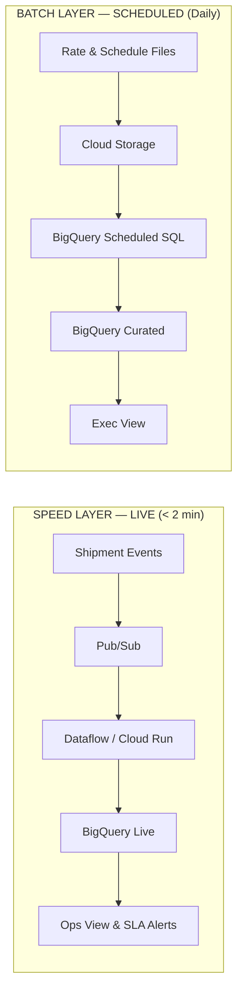

# SHP05 (Vertex Auto Parts) — Platform Architecture

- **Live (Speed Layer):** Pub/Sub -> Dataflow/Cloud Run -> BigQuery Live -> Ops View & Air-Expedite Alerts (< 2 min freshness).
- **Batch Layer (Daily):** Carrier Rate/Schedule Files -> Cloud Storage -> BigQuery Scheduled SQL -> Curated Tables -> Exec View (replaces Dataproc & Kafka to stay under $50/mo).

